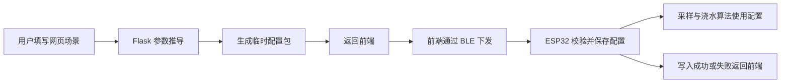
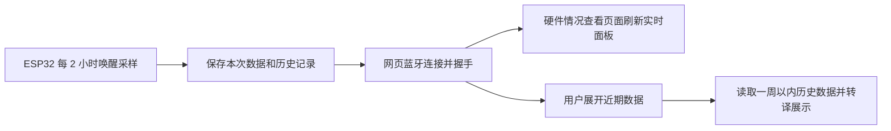

## 总体边界

| 层          | 职责                       | 不应承担         |
| ---------- | ------------------------ | ------------ |
| 浏览器前端      | 页面导航、表单填写、蓝牙连接、配置预览、结果展示、状态轮询      | 不直接决定硬件安全参数。 |
| Flask 后端   | 资料库匹配、第三方 API 调用、参数推导、临时配置包生成、系统健康监控 | 不直接控制 GPIO，不直接连接 ESP32，不保存用户配置历史。  |
| ESP32 固件   | 采样、决策、执行、休眠、日志、BLE 通信和本地配置保存           | 不依赖互联网才能浇水。  |

## Flask 前后端关系

前端负责收集：

- 植物。
- 地点/国家。
- 花盆或地栽方式。
- 花盆大小。
- 光照条件。
- 是否无人值守。
- 水源描述。

前端还负责：

- 首页硬件展示和三个快速入口。
- 蓝牙设备扫描、连接状态展示和握手触发。
- 硬件情况页面的实时数据刷新与历史数据展开。
- 个性化库编译页面的 iOS 设置式分组表单。
- 模式控制、配置上传下载、导入导出、重启和恢复出厂按钮。

后端负责：

- 从 `plants.json` 和 `locations.json` 读取知识库。
- 维护不同植物、栽培方式、地区环境的权重库。
- 调用 Open-Meteo 或其他第三方 API 获取海拔、降水、湿度、日照等环境资料。
- 使用 `derive_parameters()` 推导参数。
- 生成可通过蓝牙下发的配置数据包，并返回给前端。
- 在外部 API 失败时降级使用静态地点库，并在结果中标记 `source: fallback`。
- 提供后端健康状态、系统统计和系统日志给管理员查看。

后端不负责：

- 直接参与 BLE 通信。
- 长期保存用户配置、配置版本或传感器历史。
- 用户登录、设备注册、会话管理。
- 保存代码版本和设备同步状态。

## 配置流向

推荐的配置流向：

## 数据查看流向

## 后续建议

- 统一配置字段命名，减少 `snake_case` 与 `camelCase` 的转换混乱。
- 明确“后端生成配置、前端 BLE 下发、ESP32 本地保存”的边界。
- 设备侧交互统一通过 BLE 暴露给浏览器前端。
- 所有硬件危险参数应在固件端再次校验，不能只依赖网页端限制。
